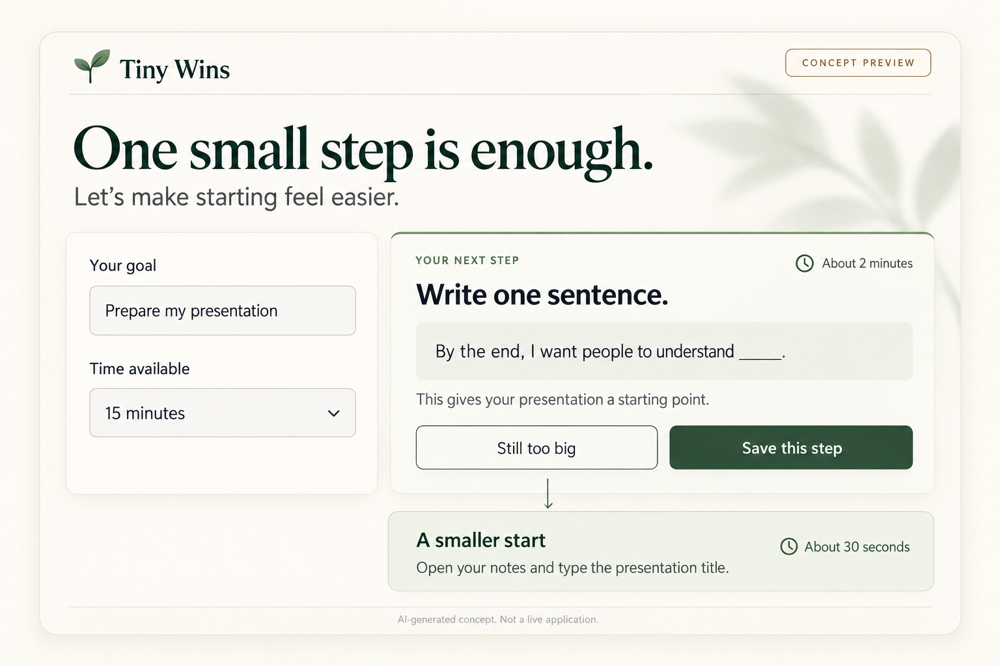

# Tiny Wins

**One small step is enough.**

Tiny Wins is a productivity agent that helps students, independent builders, and busy people turn an overwhelming task into one manageable next step.

## Project status

**Tiny Wins is complete.** The application source code is not shared in this repository for privacy reasons. This repository contains only the project README and an interface concept image.

## Privacy

The implementation is kept private. Application source code, configuration, credentials, and task data are not included in this repository. The documentation and image provide an overview of the project's purpose and experience.

## The experience

1. Describe a goal, such as preparing a presentation.
2. Choose how much time is available.
3. Receive one concrete next step, an approximate duration, and a short explanation.
4. Select **Still too big** to request a smaller action.
5. Save the chosen step and record completion.

The first run offers a friendly question and a clickable example. Responses are concise, calm, and practical. If an operation fails, the interface preserves the visible step and provides a clear way to retry.

## The delightful detail

The **Still too big** button lets someone ask for a smaller start without explaining their hesitation. A suggestion to write one sentence can become simply opening a notes file and typing the presentation title.

## Architecture overview

- **Amazon Bedrock:** interpret goals and suggest next steps.
- **Strands Agents:** connect the model to tools for reading tasks, saving steps, and recording completion.
- **Web interface:** present a simple, focused interaction.
- **Task storage:** retain task state and progress between interactions.

## Interface concept

*AI-generated design concept illustrating the Tiny Wins experience. This is a design illustration, not a screenshot of the running application.*

## Files

- `README.md` — project overview and current status.
- `tiny-wins.png` — redesigned interface concept.
